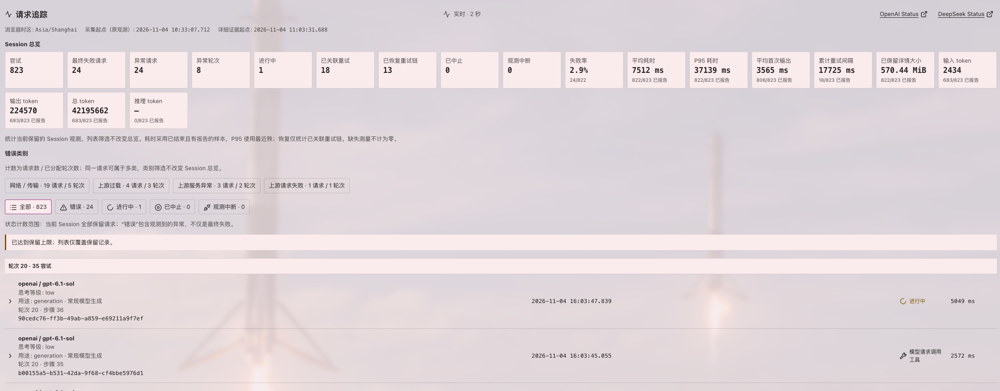
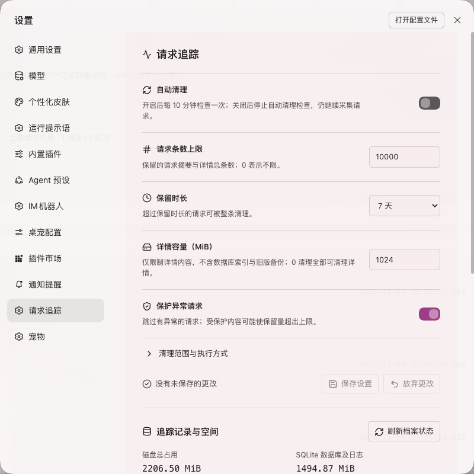

# Harness Trace 0.5.2

[版本下载](https://github.com/CherryLover/dsh-trace/releases) · [问题反馈](https://github.com/CherryLover/dsh-trace/issues)

## 界面截图

以下两张图片截取自实际运行的 Harness 0.2.1-rc.5 / Harness Trace 0.5.2，仅裁剪展示区域，未重绘界面。统计是截图时的真实观测快照，不代表全部请求均已结束。

### 当前会话的请求追踪

会话总览集中展示请求次数、失败与重试、耗时和 token 用量；下方按轮次列出请求，可按异常类型和状态筛选，并展开查看证据。



### 设置 → 请求追踪

在原生设置中管理自动清理、请求条数、保留时长、详情容量和异常保护，下方查看追踪记录与磁盘占用。本次截图未修改设置，也未执行清理。



## 独立插件发布

本仓库是可独立安装的 Harness 插件源码，不依赖开发者电脑上的其他项目。Host、Client、语言资源和图标均包含在 npm pack 生成的安装包中，第三方依赖由包管理器安装。它仍需要兼容的 Harness 宿主，不是独立桌面应用。

- **发布渠道**：GitHub Releases 的 `.tgz` 包与 `SHA256SUMS`；目前不发布 npm registry，`private: true` 用于防止误发布。保留 `@local/dsh-trace` 包名以兼容已有安装。
- **安装**：在 Harness 插件管理器中使用 Release 安装包下载 URL，或下载后选择本地 `.tgz` 包。源码开发安装可使用本地绝对目录。
- **兼容基线**：已在 Node 22.23.2、Harness 内置 Node 24.21.0 与 Harness 0.2.1-rc.5 上验证。插件使用原生 `node:sqlite`，最低 Node 22.13；其他 Harness 版本需要兼容性验证。
- **版本定位**：0.5.2 为当前功能的稳定收尾版，后续以缺陷修复为主。被动 HTTP 证据并不覆盖所有供应商传输；诊断内容和聊天历史分离，采集/脱敏边界见下文。
- **许可**：当前项目标为 `UNLICENSED`，公开仓库不等同于授予开源许可；第三方图标许可单独保留。确定开源协议后可调整。

## Git 与自动发布

主分支为 `main`。每次推送运行 Node 22/24 测试和打包检查。工作流比较该次推送前后的 `package.json` 版本：首次推送发布当前版本，后续仅版本变更时创建 `v<version>` 标签和 GitHub Release，并附安装包与校验值；已有同名版本避免重复发布。README 直接展示真实界面截图，不部署 GitHub Pages。普通改动（包括文档和截图）不创建 Release，PR 只执行检查。

日常操作：

```sh
# 普通代码更新
npm test
git add .
git commit -m "fix: describe change"
git push origin main

# 发布版本；npm version 会同步 package-lock，工作流负责标签与 Release
npm version patch --no-git-tag-version
git add package.json package-lock.json
git commit -m "chore: bump version"
git push origin main
```

请先将所有要发布的代码提交，再提交版本更新；CI 验证通过后才会发布。更新界面展示时，替换 `docs/screenshots/` 下的截图并同步 README 描述即可。

发布验收（2026-11-04）：GitHub Actions 的 Linux Node 22/24 已验证 149 项插件测试，并自动创建 `v0.5.1`，附 `.tgz` 和 SHA-256 校验文件。源码打包后也已在独立临时目录安装并成功导入 Host 模块。撤除 Pages 后保留 6 项版本检测与发布回归测试；真实桌面界面的请求追踪与设置页见上方截图。


## 0.5.2 changes / 标准图标与稳定收尾

- 设置项、保存/放弃更改、刷新、清理和存储标题统一使用 Lucide 标准线性 SVG；请求状态、状态筛选、异常诊断和外链采用同一图标体系。
- 成功、错误、进行中、工具调用、输出上限、中止与观测中断各有对应图标；保留本地化文字，不依赖颜色识别状态。图标继承主题颜色，隐藏于辅助技术，避免重复朗读。
- 只调整展示，不改变采集、诊断、清理或保存行为。本版冻结现有功能，后续以缺陷修复为主。
- 本地插件测试 154/154、发布回归测试 6/6 通过，安装包检查通过；实际桌面请求追踪及设置页截图见上方。

## 0.5.1 changes / 精简设置与空间明细

- 每个设置按“标题 + 简短说明 + 右侧控件”排列，保存/重置集中在底部；完整清理规则放在小型折叠说明中。
- 自动清理改为每 10 分钟检查。关闭时不注册清理定时器；请求记录继续按事件写入。设置保存不触发立即清理。
- 配置页移除存储目录和目录迁移选项，位置仅只读显示。兼容既有安装目录，并在插件运行期间固定，不移动或删除旧数据。
- “本地档案管理”改为“追踪记录与空间”：分列磁盘总占用、SQLite 数据库及日志、旧版 JSON 备份、已包含在数据库中的详情内容。
- 按会话列出请求条数、含详情条数和详情容量，按容量降序；点击会话标识调用原生 uiWorkspace.openSession 并关闭设置面板，单独按钮选择该会话的预览确认清理。
- 解释诊断副本包含输入上下文、工具定义、输出事件、用量、错误及捕获的 HTTP 内容；重复保存上下文会放大占用。清理不删除聊天记录，也不删除迁移前 JSON 备份。

## 0.5.0 changes / SQLite 与应用设置

Validation: 142/142 tests passed on Node 22.23.2 and installed Electron 44.7.0 / Node 24.21.0, including Host JSON migration and whole-record cache invalidation. JavaScript syntax checks and `npm pack --dry-run` passed (16 files). Actual linked plugin disabled/re-enabled with `application: applied`, no warnings; live settings get/update and archive status verified SQLite and editable native config persistence. Live Client Inspect confirmed active `dsh-trace` in `settings.section` order 80. Rendered browser layout has not been visually verified.

- 应用 **设置 → 请求追踪** 独立页集中管理自动清理、请求条数、保留天数、详情容量与异常保护，插件详情保留同一入口。通过原生 configEditor/Loader 持久化配置，不直接修改 profile 文件。
- 默认 SQLite 原生 `node:sqlite`，无需外部数据库服务或原生 npm 依赖。SQL 索引覆盖会话、时间和状态，`summary_json` / `detail_json` 保留结构化证据；请求和响应内容按原捕获上限保存。
- 全局条数上限默认 10,000，保留最近 7 天，可选 3 / 7 / 15 天；两者的 0 都表示不限。自动清理默认仍关闭，避免升级即删除既有历史。开启后每 10 分钟检查；保存设置本身不立即删除。
- 优先清理最早成功请求，默认跳过异常与进行中请求，因此受保护记录可能使条数、天数和容量超限。天数 / 条数删除整条记录；1,024 MiB 默认详情预算只淘汰详情并保留摘要。详情预算 0 表示清理全部可清理详情。
- 首次启动只读迁移旧 JSON，逐条事务记录进度并持久化完成标记；中断可恢复，完成后不再重复导入或复活已清理记录。原 JSON 不删除，其占用与 SQLite 分列统计；迁移期间总占用会增加。确认完成且备份后再自行处置旧文件。
- 手动清理仍限所选会话、预览后确认；条数上限始终按全局规划，详情预算按选中会话计算。过期预览重算并拒绝执行。SQLite 事务、完整性检查与物理回收覆盖删除流程。
- `harness_trace_settings` 与页面共享 get/update 后端；`harness_trace_manage` 保持当前会话 status/preview/cleanup。

## 0.4.1 changes / 精简展示与上游异常分类

- 视图标题改为“请求追踪”；顶部移除导出 JSON 按钮，替换为 OpenAI Status ↗ 与 DeepSeek Status ↗ 新窗口外链。常规磁盘采集、归档与既有 Host 导出 API 保留。
- 诊断默认只显示观测阶段及重要异常短标题；解释、置信度、完整 findings/gaps、证据引用和原始诊断折叠保留。
- 明确 overload 文案细分为“上游过载”，通用 request-processing 错误细分为“上游请求失败”；provider 展示为“上游服务异常”，其余证据不足项展示为“其他异常”。HTTP 429/鉴权等明确状态保留优先级；帮助中心链接或 PI_AI_ERROR 本身不作为归类依据，不推断供应商宕机。
- 历史摘要读取时重新分类，原始错误及不可变归档不改写。

Validation: 121/121 tests passed on Node 22.23.2 and installed Electron Node 24.21.0; JavaScript syntax checks and `npm pack --dry-run` passed (15 files). The actual linked bundle was disabled/re-enabled with both results `application: applied` and no warnings. Its management tool returned archive status after reactivation; live Client Inspect confirmed active `dsh-trace` at conversation view order 40. Rendered browser layout has not been visually verified.

## 0.4.0 changes / 自动证据诊断

Validation: 117/117 tests passed on shell Node 22.23.2 and the installed Harness Electron Node 24.21.0. Final client presentation adjustments passed 33/33 client tests; all seven JavaScript modules passed syntax checks and `npm pack --dry-run` passed (15 files, including diagnosis.js). The actual linked bundle was disabled/re-enabled with both results `application: applied` and no warnings; its management tool returned archive status after reactivation, and live Client Inspect confirmed active `dsh-trace` at conversation view order 40. Rendered browser layout has not been visually verified.

- 自动诊断以结构化证据生成：最深已观测阶段、已观测异常、证据缺口和 JSON-pointer 证据引用。覆盖 HTTP 错误、HTTP 成功状态后流失败、候选地址连接错误、重试关联、中止与观测中断；不扫描提示词或正常输出来推断异常。
- 异常保留 `.cause`、旧式 `.causes` 和 `AggregateError.errors`，展示候选 address / hostname / family / port / syscall / errno。每棵树最多 64 个节点、8 层、每组 16 个子异常和 64 KiB 字符预算，循环或截断明确标记。
- 被动采集 Undici `beforeConnect` / `connected` / `connectError`，每次尝试最多保留 32 条独立连接事件。仅按异步上下文弱关联，不配对连接生命周期，不断言请求/socket 对应关系，不生成虚构的 DNS/TCP/TLS 耗时。宿主运行时事实记录采集时默认值，不代表请求覆盖值或代理配置。
- HTTP 实体明确区分未观测、零字节、部分观测、捕获截断、解码失败和文本不可用。`reasonCode`、`representation`、`hashBytes` 和 `hashCoverage` 解释完整性；增量 SHA-256 覆盖已观测的内容解码前实体字节，即使文本保留已达上限也继续计数，不代表 TLS/分帧线上字节。
- 界面按“概览诊断 → 异常树 / 独立连接 / 实体状态 → 折叠原始证据”分层；HTTP 200 不等于流最终成功。诊断进入轻量索引，详情和导出按当前规则派生，不改写历史不可变快照，也不回填旧记录缺失的网络证据。


## 0.3.2 changes / 本版调整

Validation: 98/98 tests passed on shell Node 22.23.2 and Electron Node 24.21.0; final explanatory-copy check passed 27/27 client tests. `npm pack --dry-run` passed. The linked bundle was disabled/re-enabled with `application: applied`, no warnings; live Client Inspect confirmed the active `dsh-trace` conversation view. Rendered layout has not been visually verified.

Investigation: the reported 14 transport attempts comprise 12 generation requests across turns 4/7/8 and 2 unassigned compaction requests (11 `Connection error.`, 3 `terminated`). In the installed runtime, OpenAI SDK supplies the default connection-error message, pi-ai emits the error event, and Harness maps the message to `TRANSPORT`; Trace observes the normalized finish failure. Two retained details additionally contain `http-transport / AggregateError / ETIMEDOUT`, with no observed HTTP status or response headers, supporting connection-layer timeout for those two only. Their old index summaries lack compact HTTP error evidence; summary-only polling shows network, while the preserved detail errors additionally support timeout. Historical summaries are not eagerly expanded from detail files. No DNS/TLS/proxy/upstream root cause is inferred for the remaining records.

- Status filters show counts computed from the current polling snapshot with the same predicates as the displayed list. When an error category is selected, counts describe that category's requests, before applying the status filter.
- `transport`, `APIConnectionError`, and connection-error messages classify as network symptoms rather than unknown. Stored compact evidence is reclassified on read, without rewriting historical detail files. A network category does not assert that an upstream API sent an error body.
- Normalized stream evidence labels describe the capture layer, not an error. Error observation stages distinguish adapter finish, stream iteration, agent retry-decision observation, and captured HTTP responses; repeated observation is not another failed request.


An experimental installed Harness bundle, not a standalone dashboard. Open a conversation and select **Trace / 追踪** beside the other conversation views.

## 0.3.1 changes / 本版调整

Validation: 93/93 tests passed on shell Node 22.23.2 and Electron Node 24.21.0. The linked installed bundle was disabled/re-enabled successfully (`application: applied`); live Client Inspect confirmed `dsh-trace-archive` active in `plugins.detail.section`. Rendered layout has not been visually verified.

- Archive management lives on the Harness Trace **plugin management detail page**, not inside the conversation Trace view. Native configuration remains managed by Harness. Global disk usage and the selected session's retained details are labeled separately; cleanup requires selecting a session, preview and confirmation.
- Error categories support drill-down from category counts to matching rounds/attempts and their retained error evidence. Counts are attempts per category (not duplicated error observations); an attempt may belong to multiple categories. Categories are observed symptoms, not proof of upstream root cause. Unknown evidence remains explicitly unknown; cancellation and observation interruption are separate states.
- Purposes: `generation` is Trace's label for default model generation, including subsequent model steps after tool results; `compaction` summarizes context; `session-title` generates session titles. The right-side status is a model output finish reason: `tool-calls` means the model requested tool calls, **not** that a tool executed successfully; `stop` ends that model request, not necessarily the whole turn. Actual tool results belong to the conversation's tool records.
- Detail availability distinguishes historical summary-only records, verified disk cleanup, and unknown missing detail. A legacy `detailsEvicted` flag alone no longer claims a disk-budget deletion. Increasing today's budget does not reconstruct previously missing snapshots. Per-request capture limits are separate from disk and memory budgets.

## 0.3 additions / 上版新增

- Expanded overview shows the exact explicit reasoning effort immediately after model; missing values are labeled 未显式指定.
- Session Dashboard remains independent of filters: failures/anomalies, linked retry recovery, aborted/interrupted calls, timing and token reporting coverage. Error requests and entire anomalous rounds have both text and visual emphasis. Standard inline Lucide icons have accessible labels.
- Native settings expose memory cache and advanced capture limits. Retention controls live under Settings → Trace. Storage location is read-only, with legacy install paths retained; settings refresh on persistence and request events, not a one-second polling loop. Capture limits are snapshotted at each new request.
- Plugin-page archive management shows the directory read-only. Cleanup is scoped to the selected session, requires preview and explicit confirmation, and rejects stale tokens. `harness_trace_manage` exposes the same status/preview/cleanup operations to the current agent session without accepting an arbitrary session ID.

## Diagnostic interface

- Groups attempts by durable turn when available, newest rounds first and newest attempts first inside each round. Auxiliary or unscoped-turn calls are identified separately.
- All wall-clock timestamps use `YYYY-MM-DD HH:mm:ss.SSS`, with the browser timezone shown explicitly. Elapsed durations remain durations, not dates.
- Overview, Request, Response, Usage, Errors and HTTP inspection; filters for all, errors and running attempts.
- Request/response detail is fetched lazily instead of repeatedly sending conversation contents in summary polling. Export explicitly fetches full retained session evidence.
- Polls every two seconds while mounted and visible; requests are aborted on cleanup. Registration is not a rendered-layout check.

## Evidence and provenance

1. **Normalized request**: a bounded snapshot of `GenerateOptions`, excluding the non-serializable AbortSignal. Includes provider/model, messages/system, tools, sampling limits, tool history and purpose when present. It is not the adapter's serialized HTTP body.
2. **Normalized response**: bounded timestamped StreamChunk events, finish reason and adapter replay state when present. Replay state is not labeled raw HTTP. Blocks and deltas may describe overlapping content; event JSON bytes are not answer size or network traffic.
3. **Token usage**: latest finite provider-reported fields from normalized usage events, without summing cumulative reports. Missing values mean not reported, not zero. No locally estimated tokens are substituted for actual usage.
4. **Errors**: adapter finish failures, thrown stream exceptions and agent/request-error observations retain their observation stage/time. Bounded name/code/status/request ID/stack/cause chain and supported provider error fields are retained. These are locations where an error surfaced, not assertions of the originating root cause.
5. **HTTP**: passive `node:diagnostics_channel` observations of scoped Undici requests, associated using AsyncLocalStorage around every iterator operation. Only requests occurring within the observed model stream are collected. No global fetch/dispatcher monkeypatch or request-body mutation is used. Different transports and Undici versions emit different channels; absent HTTP/body evidence is reported as unavailable, not reconstructed from normalized parameters. Multiple HTTP exchanges may belong to one model attempt, including adapter-internal retries.

HTTP status 502/504 alone does not establish whether a gateway or upstream provider caused the failure. This bundle does not add DNS/TCP/TLS timing, proxy-server telemetry or upstream service traces. Request identity, original thrown exceptions, cancellation, backpressure, routing and retry decisions are preserved by the observer. Diagnostic serialization and observation still have finite local overhead.

## Byte interpretation

- Normalized request `bytes`: UTF-8 JSON representation before redaction; not network bytes. `retainedBytes` counts the redacted retained representation.
- Normalized response `observedJsonBytes`: cumulative UTF-8 representation of observed normalized events, including overlapping event content. `capturedBytes` counts retained redacted event data.
- HTTP Content-Length is a peer declaration, separate from observed body chunks. Body counters require actual diagnostics events; no events means unavailable. Request/response headers may be represented as HTTP/1-style text for a reproducible size estimate, not exact HTTP/2/HPACK/TLS bytes.
- HTTP `headerBytes` separates observed and retained header representation bytes and carries its measurement description. Diagnostic request strings may include a request line; array-based headers use a reproducible HTTP/1-style estimate. Neither is an HTTP/2/HPACK/TLS measurement.
- Body `bytes` counts observed entity bytes before content decoding; `capturedBytes` counts the retained entity prefix; `decodedBytes` is populated only when known; `retainedBytes` counts redacted UTF-8 text. Peer-declared Content-Length stays separate.
- Bounded gzip, Brotli and deflate decoding is supported. Binary/non-UTF-8 bodies, unsupported encodings, incomplete compressed data, invalid JSON and decompression overflow carry explicit unavailable reasons instead of fabricated readable content. Malformed SSE is explicitly partial. Decoded output defaults to 256 KiB and uses the configured per-entity capture cap.

## Retention and content handling

Coverage starts at activation. The original observation start and persisted v0.2 detailed-evidence start are shown separately. Old v0.1 records remain timing/error-only; details are not backfilled. In-progress observations recovered after restart are marked interrupted without invented end/duration.

This version intentionally stores prompts, messages, tool schemas, response content and supported HTTP evidence in local Host storage. Common credential keys, authorization/cookie headers, bearer values and key-like patterns are redacted heuristically; arbitrary content is not a comprehensive secret detector. Export contains retained diagnostic content from the selected session.

Default capture limits are configurable: 512 KiB normalized request text, 256 KiB normalized response events, 256 KiB per HTTP entity and 2,000 retained normalized events. Each request snapshots its own limits; changes apply to subsequent requests. Finish/replay metadata have separate fixed 16/32 KiB caps; at most 24 layered errors and eight HTTP exchanges are retained per attempt. Large/truncated/unavailable/legacy evidence is labeled; a complete export means all **retained** evidence, not unlimited wire capture.

### Disk archive and cleanup

Default root: `~/.dsh/request-traces`, database: `archive.sqlite`. SQLite stores indexed request metadata and JSON evidence in `attempts`; `metadata` and `imports` track format, revision and resumable legacy migration. Database access serializes in-process and uses SQLite `BEGIN IMMEDIATE`, full synchronization and busy timeout. Symlink/hardlink substitution is rejected; database files have mode 0600 and root directory 0700. A compatible `node:sqlite` runtime (Node >=22.13 or the tested Harness embedded Node 24.21.0) is required.

The default 32 MiB / 5,000-attempt **memory cache** is separate from disk retention. Disk checkpoints precede memory eviction. Automatic cleanup is off by default, checked every 10 minutes when enabled; disabling it removes the cleanup interval. Global defaults: 10,000 requests, 7 days, 1,024 MiB detail budget, protect anomalies. Age/count policies delete full records; detail-budget eviction retains summaries. Running calls and protected anomalies are skipped, and protected records may exceed limits. SQL database/sidecar size, retained detail bytes and original JSON backup bytes are distinct measurements. Cleanup reclaims SQLite pages but deliberately leaves original JSON untouched.

Existing storageDomain observations and old JSON archives migrate before use; source evidence remains intact on failure. Migration markers prevent reimporting already cleaned records. Restart recovery marks running attempts interrupted without invented duration. The archive location is read-only in settings. Existing legacy installation paths remain supported at startup and stay pinned for the plugin lifetime. No live directory switching or automatic copying is performed.

Read-only SQL query example (do not edit the live database):

```sql
SELECT status, COUNT(*) AS requests,
       SUM(is_error) AS anomalies, SUM(detail_bytes) AS detail_bytes
FROM attempts GROUP BY status;
SELECT session_id, attempt_id, started_at,
       json_extract(summary_json, '$.model') AS model
FROM attempts WHERE is_error = 1 ORDER BY started_at DESC LIMIT 100;
```

Snapshots are detached at checkpoint time. Progress checkpoints are at most roughly once per second, coalesced writes run outside iterator awaits, and disposal flushes pending writes. Sudden process termination may lose the newest unflushed observation. Storage failures remain visible. Credential redaction is heuristic, not comprehensive.

Retry linkage requires an observed retry decision or matching durable `llm/retry` evidence. Retry gaps are wall-clock end-to-start gaps, not just configured backoff. First effective output includes text, reasoning and nonempty tool-call deltas; it is not necessarily visible answer text or HTTP first byte. Accumulated attempt duration may exceed wall-clock span if attempts overlap; span includes idle time.

## Development and installation

```sh
npm install --ignore-scripts
npm test
node --check index.js
node --check core.js
node --check evidence.js
node --check transport.js
node --check client.js
```

Install through the Harness plugin manager using `link:/absolute/path/to/dsh-trace`. Do not edit profile manifests or runtime source manually. Both Host and Client are native JavaScript; no standalone server or frontend build is used. A linked bundle needs dependencies installed in its own directory. Follow plugin-manager activation/next-step results; an updated package may need a Harness restart to load a fresh module generation. Refresh the existing GUI for Client updates; no same-checkout development watcher has been verified.

Deployment verification for the previous v0.2 release established active registration at conversation view order 40. v0.3 installation returned `application: applied`; its live management tool successfully reported the default archive root and retention statistics, and Host Config inspection returned all 11 editable fields with `volatile: true`. Registration and Host execution are not rendered visual verification. Linked module replacement can require a Harness restart and refresh of the existing GUI. Direct unauthenticated API probing received HTTP 401; browser credentials were not accessed. Historical v0.1 attempts remain timing/error-only.

The earlier 36-test v0.2 baseline passed in shell Node 22.23.2 and the installed Harness Electron Node 24.21.0; v0.3 adds archive, configuration, management, migration, Dashboard and cache separation regressions: all 78 tests pass in both runtimes. Local HTTP fixtures confirm native Fetch body diagnostics in Harness (built-in Undici 7.29.1); shell Node 22's native Fetch (Undici 6.28.0) exposes headers/status but not body chunks. Installed npm Undici with its own Agent exposes body chunks on both runtimes. These fixture results establish runtime capability, not coverage of every provider transport.

Tests cover normalized capture, UTF-8 limits, redaction, usage, exception identity, hostile thrown values, partial output, retry evidence, cancellation, detail retention, lazy detail/session isolation/export, persistence/recovery/disposal and transport observation. Actual authenticated browser rendering and responsive layout require an in-GUI check when no browser-control channel is available.
